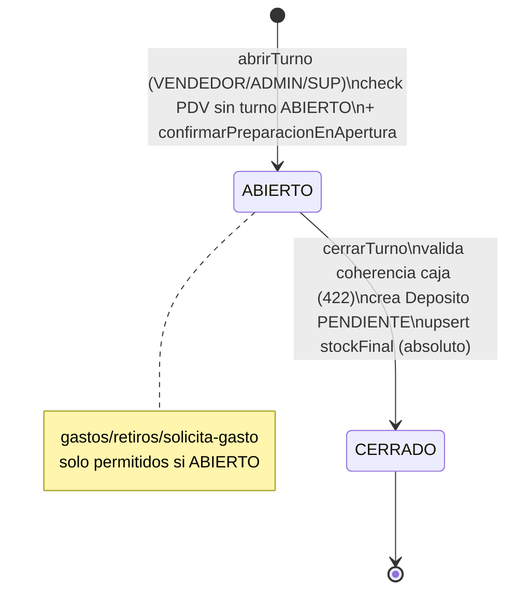
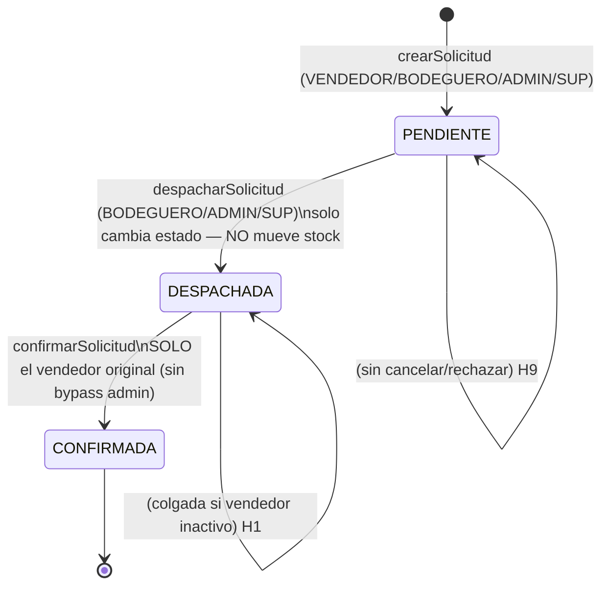
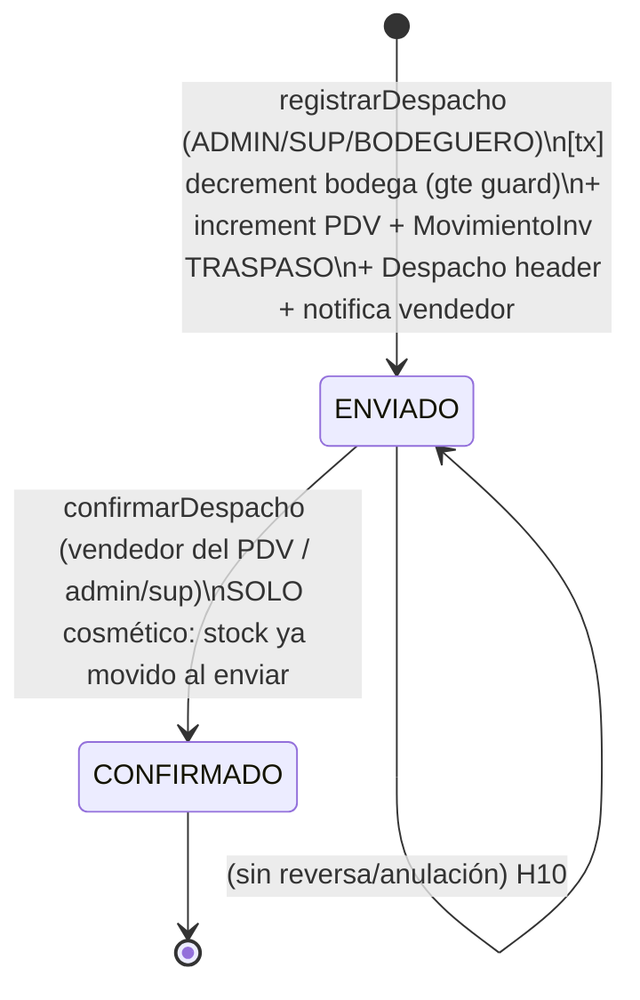
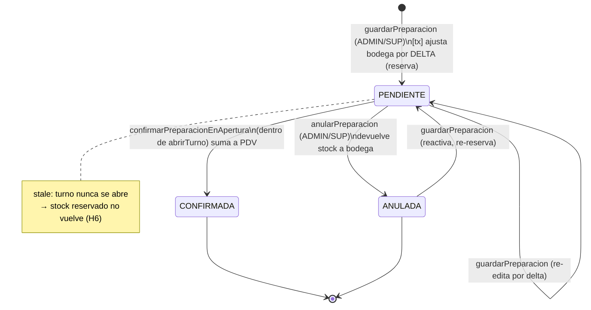
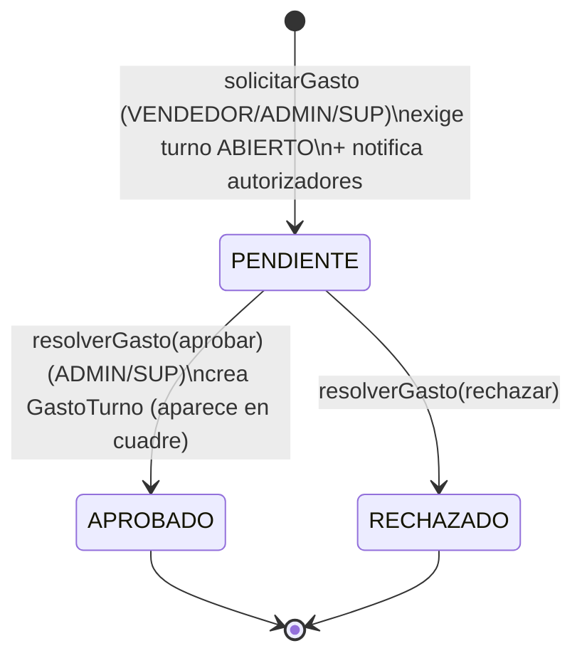
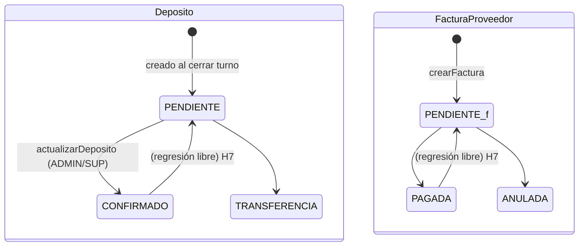

1# Fase 1 — Flujos de tareas (máquinas de estado reales)

> Reconstruido leyendo los servicios, no la documentación. Foco: transiciones reales, quién dispara, qué valida, qué pasa si falla a medias, idempotencia y races.
> Convención: **[bug]** = defecto; **[diseño]** = decisión discutible pero deliberada.

---

## 1. Turno de caja (`EstadoTurno`)

Apertura acopla la confirmación de la **preparación** del día (misma transacción). Cierre persiste turno + depósito + stock final en una transacción.

- **Disparadores:** apertura = vendedor (o admin/sup en modo POS). Cierre = dueño del turno o admin/sup.
- **Validación cierre:** identidad de cuadre (efectivo/venta/diferencia) → 422; chequeo blando vs gastos/retiros en BD → solo `console.warn`.
- **Idempotencia cierre:** ✅ `updateMany where estado=ABIERTO`, `count===0` → 409. Bien resuelto.
- **Idempotencia/race apertura:** ❌ ver **H2**.

---

## 2. Solicitud / pedido de insumos (`EstadoSolicitud`)

- **[diseño] Desacople total con el stock real:** el estado es puramente contable; el movimiento ocurre por el flujo de **Despacho** (§3), sin vínculo. → **H4**.
- Sin estado de rechazo/cancelación (**H9**); confirmación sin bypass admin (**H1**).

---

## 3. Despacho bodega→PDV (`EstadoDespacho`) — único flujo que mueve stock

- **Concurrencia stock:** ✅ decremento condicional `updateMany ... stock_actual gte cantidad` dentro de tx → nunca negativo aunque dos despachos compitan.
- **Idempotencia del POST:** ❌ un reintento crea segundo lote y mueve stock 2×. → **H8**.
- **Confirmación:** ✅ idempotente (si ya CONFIRMADO retorna). Sin reversa para despacho erróneo → **H10**.

---

## 4. Preparación del siguiente turno (`EstadoPreparacion`)

Regla anti-doble-conteo: bodega baja al **PREPARAR**, PDV sube al **CONFIRMAR** (dentro de la apertura de turno). Nunca ambas.

- **Transacciones:** ✅ ajuste de bodega + upsert cabecera + reemplazo de ítems atómicos. CONFIRMADA no se modifica (409). Fechas `@db.Date` (mediodía UTC) consistentes entre guardar y confirmar → sin mismatch DST.
- **Hueco:** preparación PENDIENTE de fecha pasada sin apertura → reserva colgada (**H6**).

---

## 5. Solicitud de gasto con autorización (`EstadoGasto`)

- **Idempotencia:** ✅ `resolverGasto` exige `estado===PENDIENTE` (409 si ya resuelto).
- **[bug] Sin re-check de turno al resolver:** entre solicitar y aprobar el turno puede cerrarse; el `GastoTurno` se crea igual pero el cuadre ya se persistió sin él. → **H3**.

---

## 6. Depósito (`EstadoDeposito`) y 7. Factura proveedor (`EstadoFactura`)

- **[bug] Sin máquina de estados:** ambos hacen `estado: data.estado as any` sin validar transición → cualquier salto/regresión pasa. → **H7**.

---

## 8. Cierre preventivo (registro simple, sin máquina de estados)

- `registrarCierrePreventivo` crea un registro; `monto_retiro` **informativo**, desacoplado de `RetiroTurno`. Documentado. Riesgo de descuadre si el retiro real nunca se registra por POS (además, POST retiros es ADMIN/SUP only). → **H11**.

---

## Tabla de hallazgos

| # | Sev. | Descripción | Archivo:línea | Impacto | Fix propuesto |
|---|------|-------------|---------------|---------|---------------|
| **H1** | Alto | Solicitud queda en DESPACHADA sin salida: `confirmarSolicitud` exige ser el vendedor original, la ruta permite ADMIN/SUP/BODEGUERO pero el servicio los rechaza. Si el vendedor se desactiva, nadie puede confirmar. | [solicitudes.servicio.ts:87-91](backend/src/servicios/solicitudes.servicio.ts#L87-L91) | Pedidos colgados para siempre; cola sucia | Permitir bypass ADMIN/SUP (o BODEGUERO) en confirmar, o transición de cierre administrativo |
| **H2** | Alto | TOCTOU en apertura: `findFirst(ABIERTO)` fuera de la tx; sin unique parcial `(pdv_id, estado=ABIERTO)`. Dos aperturas concurrentes → 2 turnos abiertos. | [pos.servicio.ts:32-57](backend/src/servicios/pos.servicio.ts#L32-L57) | Caja duplicada, cuadres inconsistentes | Unique parcial en DB / columna derivada `turno_activo_pdv`, o guardia dentro de la tx |
| **H3** | Alto | `resolverGasto(aprobar)` no revalida turno ABIERTO. Gasto aprobado tras el cierre crea `GastoTurno` que no entra al cuadre ya persistido. | [gastoAutorizacion.servicio.ts:150-164](backend/src/servicios/gastoAutorizacion.servicio.ts#L150-L164) | Descuadre silencioso gastos vs cierre | Exigir turno ABIERTO al aprobar (o bloquear resolución de turnos cerrados) |
| **H4** | Alto | Solicitud↔Despacho desacoplados: el estado DESPACHADA no está ligado al movimiento real; se puede marcar sin despacho o despachar 2×. Sin idempotencia cruzada. | [solicitudes.servicio.ts:5-13](backend/src/servicios/solicitudes.servicio.ts#L5-L13) · [bodega.servicio.ts:96](backend/src/servicios/bodega.servicio.ts#L96) | Doble conteo / entregas fantasma; el estado miente | Unificar (confirmar solicitud dispara `registrarDespacho`) y vincular `lote_id`↔`solicitud_id` |
| **H5** | Medio | Cierre sobrescribe stock **absoluto**: un despacho recibido durante el turno (incrementa PDV) se pierde si la vendedora contó antes. | [pos.servicio.ts:147-161](backend/src/servicios/pos.servicio.ts#L147-L161) | Drift de inventario, unidades desaparecen | Conciliar por delta + alerta de divergencia, o forzar recuento post-despacho |
| **H6** | Medio | Preparación PENDIENTE stale: si el turno no se abre, el stock reservado (descontado de bodega) nunca vuelve. Sin expiración. | [preparacion.servicio.ts:242-251](backend/src/servicios/preparacion.servicio.ts#L242-L251) | Stock de bodega bloqueado; subestima disponibilidad | Job/expiración que anule preparaciones PENDIENTE de fechas pasadas devolviendo stock |
| **H7** | Medio | `Deposito`/`FacturaProveedor`: `estado` con cast `as any`, sin validar transiciones → regresiones (CONFIRMADO→PENDIENTE, PAGADA→PENDIENTE). | [finanzas.servicio.ts:52-67](backend/src/servicios/finanzas.servicio.ts#L52-L67) · [proveedores.servicio.ts:158-165](backend/src/servicios/proveedores.servicio.ts#L158-L165) | Trazabilidad financiera inconsistente | Validar transiciones permitidas + tipar con el enum Prisma |
| **H8** | Medio | `registrarDespacho` sin idempotencia: reintento de red crea 2º lote y mueve stock 2×. | [bodega.servicio.ts:96-198](backend/src/servicios/bodega.servicio.ts#L96-L198) | Doble descuento bodega / doble ingreso PDV | Idempotency-key del cliente o dedupe por (destino, hash items, ventana) |
| **H9** | Medio | Solicitud PENDIENTE sin rechazo/cancelación → contamina la cola del bodeguero permanentemente. | solicitudes.servicio.ts (ausente) | Cola de pedidos inflada, ruido operativo | Agregar estado CANCELADA/RECHAZADA con permiso |
| **H10** | Medio | Despacho ENVIADO sin reversa: un despacho erróneo exige ajuste manual de stock; CONFIRMADO es cosmético. | [bodega.servicio.ts:570-618](backend/src/servicios/bodega.servicio.ts#L570-L618) | Correcciones manuales propensas a error | Acción de reversa transaccional (devuelve stock, marca ANULADO) |
| **H11** | Bajo | `CierrePreventivo.monto_retiro` desacoplado de `RetiroTurno`; si no se registra el retiro real, descuadre. Además vendedores no pueden registrar retiros (POST solo ADMIN/SUP). | [cierrePreventivo.servicio.ts:38-46](backend/src/servicios/cierrePreventivo.servicio.ts#L38-L46) | Descuadre de caja | Vincular / generar `RetiroTurno` al registrar cierre preventivo |
| **H12** | Bajo | `getTurnoConAcceso` usa OR laxo (`usuario_id != id && pdv_id != pdvId`): un vendedor ve gastos/lecturas de turnos de OTRO vendedor del mismo PDV. | [pos.servicio.ts:19-27](backend/src/servicios/pos.servicio.ts#L19-L27) | Fuga de datos de caja entre pares del mismo punto | Revisar si es intencional; si no, exigir dueño exacto salvo admin |

---

## Transiciones huérfanas / estados sin salida

| Estado | Flujo | Problema | Ref |
|--------|-------|----------|-----|
| Solicitud **DESPACHADA** | pedidos | Sin salida si el vendedor original queda inactivo (no hay bypass admin) | H1 |
| Solicitud **PENDIENTE** | pedidos | Sin transición de cancelación/rechazo | H9 |
| Preparación **PENDIENTE** | preparación | Stale: fecha pasada sin apertura → reserva de bodega colgada | H6 |
| Despacho **ENVIADO** | bodega | Sin reversa/anulación de un envío erróneo | H10 |
| Deposito **CONFIRMADO** / Factura **PAGADA** | finanzas | Regresión libre de estado (no es sink real) | H7 |
| SolicitudGasto **APROBADO** post-cierre | gasto | Efecto (GastoTurno) no llega al cuadre ya cerrado | H3 |

---

## Idempotencia / transacciones — resumen

- ✅ **Bien:** `cerrarTurno` (guard updateMany), `despacharSolicitud`/`confirmarSolicitud`/`confirmarDespacho`/`resolverGasto` (guard por estado), decremento de stock condicional (bodega y preparación), todas las operaciones multi-paso envueltas en `$transaction`.
- ❌ **Débil:** `abrirTurno` (race, H2), `registrarDespacho` (sin idempotency-key, H8), `actualizarDeposito`/`actualizarEstadoFactura` (sin máquina de estados, H7).
- **Efectos fuera de tx:** notificaciones de despacho se envían tras confirmar la tx (aceptable: si falla la notificación, el dato ya está consistente).

## No determinable sin ejecutar
- La probabilidad real de las races (H2, H8) depende de la concurrencia efectiva y de si MySQL corre en `READ COMMITTED` vs `REPEATABLE READ`; no se verificó el nivel de aislamiento configurado.
- El impacto de H5 depende de si operacionalmente los despachos llegan con turno abierto; no se puede medir sin datos de producción.

---

**FASE 1 COMPLETA.** Esperando **"continúa"** para la Fase 2 (usuarios, roles y permisos: matriz Rol×Recurso×Acción, capa de aplicación, endpoints sin verificación y divergencias front/back/DB).
